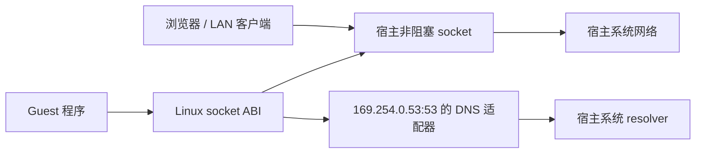

# 默认网络：原生连接与系统 DNS

CLI 和 iPad LocalSession 默认采用 `full` 原生网络。TCP/UDP 直接进入宿主
非阻塞 BSD socket；普通数据不再经过 smoltcp、10.0.0.1 或额外的 NAT/转发。
guest fork/dup 保持同一个 socket 的引用和 Linux 文件描述符语义。

## 监听和地址

- `127.0.0.1:PORT` 指宿主 loopback，可供同一设备的其他进程访问。
- `0.0.0.0:PORT` / `[::]:PORT` 使用宿主监听能力。LAN 客户端访问宿主的实际
  地址和端口，不需要额外的 Trames 端口转发配置。
- `full` 模式不额外禁止 1024 以下端口，最终由宿主 OS 的身份、沙箱和权限决定。
  `outbound`/`loopback` 保留先前的端口限制。guest root 不授予宿主 root 权限。
- 可显式选择 `off`、`loopback` 或 `outbound`；库中未配置的 VFS 仍默认 Off。
  `--virtual-network ID` 继续明确选择旧的独立 packet fabric。

网络受 iOS 的本地网络许可、实际路由/VPN、Wi-Fi 客户端隔离及 App 生命周期约束。
切换到 Safari 后 App 可能被挂起；直接监听不等于后台常驻服务。真机 Safari/LAN
访问与前后台生命周期仍需 iPad 验收。没有申请 TUN、VPN 或网络扩展权限。

逻辑 `eth0` 展示宿主当前主要活动接口复制来的 IPv4/全局 IPv6 地址和前缀，
快照最多缓存一秒；不复制宿主 MAC、接口索引或修改宿主接口。`lo` 对应宿主回环。
读接口的 ioctl/netlink/proc 使用这一视图，默认路由展示为交由宿主处理，不伪造
10.0.0.1 下一跳。MTU 仍是逻辑值，链路计数来自 guest 实际 socket 数据传输，
不是完整宿主线速包统计。1.0.0 后开发分支已支持只有私有 lo 的独立 netns，
以及可配置 veth/bridge、IPv4/IPv6 地址、直连/静态路由的内部 IP 数据路径。
根 guest 到容器／bridge 地址的 TCP/UDP 已通过双路径 socket 接通，通配监听
同时接收原生与 guest 流量，普通原生客户端仍不进入 fabric。内部跨桥 IPv4/
IPv6 转发受各自 netns sysctl 控制，默认关闭；它不开放容器到宿主外网的转发。
完整动态路由通知、外部转发/NAT 和 IPv6 scope 仍待扩展，
见[根网络／转发验收](../validation/container-forwarding.md)。
容器后续网络路线见[设计](container-network-design.md)，根 guest 直连路径保留。

## 系统 DNS

当前 CLI 与 iPad 默认 `/etc/resolv.conf` 为 `nameserver 169.254.0.53`。Docker 会过滤容器配置中的 loopback nameserver，使用此地址无需专用 Docker DNS 配置。它仅在 Trames 的 socket
层识别此地址的 53 端口，没有在宿主抢占 DNS 端口，也不是默认 IP 网关。
普通 UDP/TCP 流量和用户指定的其他 DNS 地址仍直接进入宿主 socket。
iPad 启动时替换完全匹配旧内置网关配置的 resolver 文件；自定义内容保持不变。
CLI 在文件缺失时创建默认配置，已有 store 的 resolver 由用户选择是否更换。旧的 `127.0.0.53` 适配仍可用于根网络。

复用已有系统 resolver worker，支持 A/AAAA、UDP 和带长度前缀的 TCP 查询、
响应 transaction ID/源地址、UDP 截断及 TCP 半关闭。真实 musl 仍负责名称解析
协议和 `/etc/hosts`；应用 TLS 和证书校验不变。不是通用递归 DNS 服务：其他
记录类型明确返回 NOTIMP，未实现任意 DNSSEC/权威服务器功能。

每个网络对象最多八个在途查询；每个 endpoint 最多八个响应/在途查询、8 KiB
TCP 输入和 4096 字节单查询。请求在五秒后返回 SERVFAIL；迟到结果按 token
丢弃。resolver 线程按需建立，endpoint 关闭不会被迟到结果复活。仅等待 DNS
endpoint 时将原生 poll 等待上限缩短到两毫秒，普通连接的等待策略不变。

## ICMP 与限制

保留 ICMP datagram 能力，另将 guest `SOCK_RAW` echo 请求适配到宿主
**非特权 ICMP datagram** socket。没有宿主 raw socket。恢复 Linux IPv4
头部、guest echo identifier、校验和和接收 TTL/hoplimit；支持 BusyBox ping
所用的选定 socket 选项与 ICMPv6 filter。每个 socket 限定一个 echo identifier，
单请求 8..1400 字节；其他 ICMP 类型和任意原始 IP 报文不支持。

宿主不允许 ICMP datagram 时返回实际权限错误。当前云工作区的 ping group
限制禁止此能力，因此本地只能验证拒绝路径；允许 ICMP 的 CI 强制验证真实
IPv4/IPv6 echo、identifier 和校验和，不能用模拟回复代替验证。

## 性能

此改动移除普通连接的 packet fabric、协议栈重组与网关 socket 桥接路径，
仍保留 Linux ABI 转换、guest 内存复制和现有内核调度边界。没有改变 CPU
工作线程的访存模型，也没有增加逐指令检查。本批没有新的吞吐/延迟跑分，
不报告推测的加速比。

## Large stream writes (2026-11-04)

Runtime `d9c4a811faf316a51b1a8f33f055247943a18855` treats the existing
1 MiB staging bound as one accepted TCP prefix. A larger `sendall` therefore
progresses through ordinary short writes instead of receiving EMSGSIZE. The
socket's immutable type follows accept and endpoint transitions without a host
query or another hot-path lock. UDP keeps atomic message size enforcement.
Retained sendmsg/sendmmsg/uring preparation copies only the accepted prefix;
batch accounting retains the original request length and prevents replay.
The original 3,777,458-byte Python reproducer passes without application changes.
See the [shared contract](../../runtime/docs/architecture/execution-backends.md#stream-prefixes-and-logical-futex-retirement-2026-11-04)
and [validation record](../validation/reader-runtime-20261104.json).
