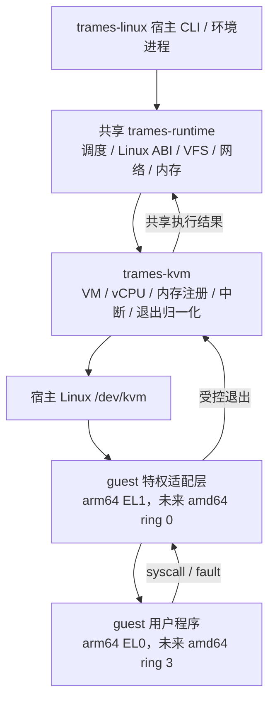

# Trames Linux：共享 runtime 与 KVM 执行后端计划

状态：调研与实施建议，尚未开始实现。日期：2026-11-24。

本轮交付是计划；创建 `trames-linux` 仓库、实现后端、部署 Linux 测试机另属实施阶段。
现有 runtime 的迭代继续进行，Linux 产品通过明确的 runtime commit 与它共同演进。

## 1. 建议与产品边界

新增独立产品仓库 `trames-linux`，与 iPad、Mac 一样将
`trames-runtime` 固定为 `runtime/` Git submodule。Linux 产品拥有 KVM transport、
Linux 宿主集成与产品入口；Linux guest 的进程、文件、网络、系统调用语义继续由
同一份 runtime 实现。

首期目标是 **Linux arm64 宿主运行 Linux arm64 用户程序**，交付可交互、可持久化、
可多核执行的命令行环境。KVM 负责执行 guest 指令，Trames 负责 guest Linux ABI。
后续增加 **Linux amd64 宿主运行 Linux amd64 用户程序**；把宿主 OS、执行后端、
guest 架构作为三个独立维度，新增代码不将 Linux/KVM 等同于 AArch64。

跨 ISA 执行不由本计划中的 KVM 后端提供；例如 arm64 宿主执行 amd64 ELF 需要另外的
解释器或动态翻译后端。配置必须明确报告不支持的宿主/guest 架构组合。

首期不包含桌面 UI、GPU/音视频、Android 产品验收、OCI/containerd 接入与 VM 迁移。
保留这些服务的能力边界，按后续产品阶段接入；基础 Linux syscall 仍复用全部已实现的
共享语义，不另做一套精简 syscall 内核。

## 2. 源码调研结论

本次审阅了 iPad 工作区、其中的 runtime，以及独立 Mac 工作区。审阅时 HEAD：

- iPad：`f5b77680`。
- runtime：`42e58346041335df8ef995119abc7f6cfab555ca`。
- Mac：`2a9955862e184d6229fb41f53949f4772b647354`。

HEAD 用于标记调研基线。runtime 工作树存在正在进行的 FUSE、内存及网络等修改；
本文不把这些工作树内容视为已发布、已验证的新基线。实施时重新选择已验证 commit。

| 当前证据 | 对 Linux 产品的含义 |
| --- | --- |
| runtime README 已明确拥有执行契约、内存、ELF、Linux ABI、进程调度与资源语义；产品拥有执行 transport | 第三个产品符合现有拆分方向，不需要 fork runtime |
| `trames-engine::Cpu` 将可移动 task state 与 worker 本地 `Engine` 分开；已有中断、并行 view 和硬件等待接口 | KVM 可以接入现有 worker/scheduler，避免重写进程内核 |
| Mac 用 `Runtime<trames_hvf::kernel::Cpu>`，以小型 EL1 适配层执行原始 ARM64 用户指令 | 可复用设计及公共契约；HVF API 本身需要独立替换 |
| `HardwareStorage`、`HardwareRange`、`SharedMapping` 与 `HardwareWait` 已存在 | KVM 必须接入同一字节所有权、借用撤销和阻塞唤醒契约 |
| runtime 的宿主内存已有 Linux `memfd`/`mmap` 路径，网络已有 Linux 分支；CI 声明 Ubuntu/macOS 构建 | 现有 Linux 宿主基础可复用，但这些检查不证明 KVM 后端已可用 |
| Mac `machine.rs` 明确要求 16 KiB 宿主页，汇编向量包含 SME2 和 Mach-O 符号约定 | 不能整目录复制成 Linux 后端；先分离通用 ARM64 逻辑和平台实现 |
| `Registers` 暴露 `x()`；`Cpu` 快照固定为 `Aarch64State`；ELF 只接受 machine 183；syscall dispatcher 读取 `x8/x0..x5`；signal/ptrace 使用 AArch64 状态 | 当前 runtime 没有完成 guest 多架构抽象，amd64 是一项真实的 ABI 工程 |
| runtime 已有名为 `trames-linux` 的 syscall crate，也有产出 `trames` 的 `trames-control` | 新产品仓库可叫 `trames-linux`，产品 Cargo package 应另命名；宿主 CLI 与 guest 控制程序分开打包 |

源码入口见文末。本文是源码与官方接口调研，没有运行 KVM、测量性能或证明产品兼容性。

## 3. 执行架构



宿主程序仍是普通用户态进程，使用内核 KVM 接口取得硬件执行能力。guest 特权层只做
异常、页表、寄存器和返回适配，不在里面再实现 Linux syscall、VFS 或调度器。
这与已有 Mac 产品的分工一致。gVisor 的 KVM 平台也采用进程模型与用户态内核的组合，
可作设计参照，但无需复制它的整套进入/退出机制。[gVisor 官方平台说明](https://gvisor.dev/docs/architecture_guide/platforms/)

### 3.1 arm64 的 syscall 与异常路径

设计路径：EL0 的 `svc` → EL1 vector → 保存 guest 状态和 ESR/FAR/ELR → 受控退出
至宿主 → 共享 runtime dispatch → 写入结果或 signal frame → EL1 恢复 → `eret`。
`svc` 首先进入 guest EL1，不能把它假定为一次直接面向用户态 VMM 的 KVM exit。

退出通道建议以 **保留的 MMIO doorbell + 每 vCPU mailbox** 为基础实现；仅在 EL1
可访问的映射中放置 mailbox、vector、页表与 doorbell，guest EL0 无权改写。
doorbell 使用固定宽度的简单访存，不接受 guest 提供的宿主指针。

另一条候选是 SMCCC filter 将明确选择的调用转发至用户态，作为能力可用时的可选路径。
普通 `hvc #imm` 不直接继承 HVF 的退出约定；先证明 KVM 上的路由和恢复行为。
SMCCC filter 必须在首次执行前配置，并避开内核保留的 function ID 范围。
[KVM ARM VM/SMCCC 控制接口](https://docs.kernel.org/virt/kvm/devices/vm.html#group-kvm-arm-vm-smccc-ctrl)

MMIO/相关退出的内核待完成操作，要按 KVM 契约重新进入 `KVM_RUN` 完成后，才允许保存
为可移动 task state、切换地址空间或复用 vCPU。不能只修改 PC 就宣称指令已经完成。
[KVM 退出与完成规则](https://docs.kernel.org/virt/kvm/api.html#the-kvm-run-structure)

归一化后的事件应区分 syscall、内存 fault、非法指令/断点、抢占、协商后的 native call
以及 host transport error。用户内存 fault 进入既有 signal/分页语义；宿主 KVM 错误
保持宿主错误。EL1 自身异常单独诊断，避免递归 vector 或误报成 guest `SIGSEGV`。

### 3.2 VM、进程和 vCPU 的关系

建议首期每个环境对应一个宿主进程、一个 KVM VM；一个执行 worker 持有一个 vCPU。
guest 进程仍使用 runtime 的 PID/mm/files/signal 对象，不映射为宿主进程或独立 VM。
同一环境中多个 mm 由独立 stage-1 页表与 ASID 区分；guest 线程数量不决定 vCPU 数量。

task state 可以迁移到其他 worker；vCPU 在其 worker 中创建、执行和销毁，保留既有
engine 本地所有权。KVM fd/thread 的调用约束也支持这一分工。
[KVM fd 与线程使用约定](https://docs.kernel.org/virt/kvm/api.html#general-description)

产品不增加协调线程、资源服务线程或轮询消息总线。短 syscall 和 native 调用优先在
当前 worker 继续；实际共享资源使用既有对象锁/原子操作。阻塞 I/O、futex、分页等待
归还执行槽，使用现有 `HostWait`/completion/readiness 机制继续。

### 3.3 内存与页表

三层地址必须明确：guest VA → guest physical/IPA → host backing。guest 高虚拟地址
不直接当作 GPA，避免将 guest VA 宽度错误地转成 KVM IPA 要求。

- runtime 是 VMA、权限、COW、共享文件页、backing 生命周期的唯一语义来源。
- KVM 注册稳定 backing arena，stage-1 页表映射这些 arena 中的页。
  slot 数量有上限，应按 arena 分配，不能每个 4 KiB guest page 占一个 slot。
- 初期普通可由宿主访问的共享 RAM backing 即可；保密 VM/private guest memory
  不属于本期，不能妨碍 runtime 对 guest 字节的既有访问。
- ELF、syscall、native 调用与硬件 CPU 观察相同物理字节；普通路径不维护每次退出时
  全量复制或对比的影子 RAM。
- guest 的读写执行权限和 COW 主要由 stage-1 PTE 表达；不以 slot 级 dirty logging
  代替 runtime 的 COW/脏页/文件持久化语义。
- `begin_host_access` 必须在产生 Rust 引用前排除该 backing 的所有硬件访问，包括其他
  mm 的别名；`end_host_access` 后才恢复相应权限。复用现有契约与必要同步边界。
- munmap、mprotect、COW、ASID 复用和 backing 回收包含明确的 PTE 发布、TLBI 与确认
  顺序；只停止实际受影响的参与者。最后一个硬件访问者退出前不能回收 owner。
- 代码发布保留 ARM 所需的 I-cache/D-cache 同步；覆盖宿主装载代码和 guest JIT。
  guest 自修改代码保留其原有架构责任，不给普通数据读写加额外屏障。

KVM 的 slot 上限、内存注册和 IPA 能力都应在启动时探测。
[KVM 内存注册接口](https://docs.kernel.org/virt/kvm/api.html#kvm-set-user-memory-region)

分别记录 `guest_page_size`、`host_page_size`、stage-1 granule、backing 对齐与 arena
大小。当前 runtime 的 4 KiB guest ABI 可作为 arm64 首期 profile；它不等于要求所有
宿主都为 4 KiB。首个验收宿主建议选 4 KiB Linux 内核，随后增加 16/64 KiB 宿主页矩阵。
非 4 KiB 宿主先验证 KVM/CPU 支持的 stage-1 粒度，以及子页权限、COW、借用和回收的
可实现性；不满足时清楚拒绝该组合，不能偷偷改变 guest ABI 或放宽相邻子页权限。

Linux 宿主回收先复用普通 demand paging 与既有 runtime 内存预算。避免默认 `mlock`
全部 guest RAM；`MADV_DONTNEED` 只用于语义允许丢弃的页。活跃脏页若要显式回收，需
保留恢复来源或接入已有存储方案；不能把宿主回收直接当作 guest 内容作废。

### 3.4 抢占、计时与异步退出

纯计算循环也必须能被时间片、kill、signal、调试暂停和映射撤销打断。KVM 的
`immediate_exit` 在进入 `KVM_RUN` 时检查；跨线程改这个字节不能单独当作踢出正在执行
vCPU 的机制。设计采用目标线程通知配合 entry gate，并验证丢失唤醒竞态。
[KVM immediate_exit 规则](https://docs.kernel.org/virt/kvm/api.html#the-kvm-run-structure)

候选实现为保留的宿主 signal + 既有 deadline/wakeup 路径；必要时使用内核向目标线程
投递的定时器，不使用会生成额外服务线程的通知方式。handler 只做 async-signal-safe
操作和必要状态发布，不在 handler 里分配、拿 runtime 对象锁或运行 syscall dispatcher。

必须覆盖退出发生在 EL0、vector 保存中、恢复中、doorbell 待完成中等位置的状态恢复。
中断 handle 在 vCPU 销毁或线程标识复用前失效；不以忙等补偿协议缺陷。

硬件指令数保持 unavailable；时间片使用实际时间。guest 时钟、vDSO 与 runtime
monotonic clock 需要一致的域；尚未建立稳定 counter 映射时使用 syscall 时钟路径。
首期不承诺 PMU、SVE/SME、MTE 或 PAC 等扩展，HWCAP/procfs 必须符合实际配置的 vCPU
和已经实现的上下文/ABI，而不是照抄宿主或 iPad 的特性集合。

## 4. 仓库与多架构边界

建议目录，均是待创建内容：

```text
trames-linux/
  Cargo.toml
  runtime/                         # 同一 trames-runtime 的显式 submodule pin
  crates/trames-kvm/
    src/vm.rs                      # fd、能力、memslot 与生命周期
    src/vcpu.rs                    # worker 本地执行、kick、exit 完成
    src/memory.rs                  # HardwareStorage/Range 适配
    src/arch/aarch64/               # EL1、寄存器、页表、异常归一化
    src/arch/x86_64/                # 后续实现，不放伪成功占位
  crates/trames-linux-app/          # package 避开已有 trames-linux crate
    src/                           # 宿主 binary trames、环境/终端/配置
  tests/                           # KVM 集成、共享 fixtures 的驱动适配
  docs/validation/
```

新增共享代码的归属：

| 层 | 负责 | 避免混入 |
| --- | --- | --- |
| runtime 通用语义 | 进程、资源、调度、backing 与借用协议 | KVM ioctl、HVF、宿主 UI |
| runtime guest arch 模块 | syscall 编解码、ELF machine/auxv、signal/ptrace/TLS/vDSO/rseq 等 ABI | `/dev/kvm` 或 AppKit |
| 产品 KVM arch 模块 | 特权适配层、KVM 寄存器映射、硬件页表及退出通道 | 一份新的 Linux syscall 实现 |
| Linux 产品层 | CLI、宿主终端、数据目录、环境生命周期与宿主服务接入 | guest ABI 常量 |

同一 AArch64 特权逻辑若能被 HVF/KVM 原样使用，可在实现第二个调用者时提取到 runtime
的纯架构模块；transport 仍在产品中。先对齐契约和复用可证明相同的逻辑，不把整个
`trames-hvf` 泛化成一个必须同时重写两个产品的巨大 transport 抽象。

### 4.1 arm64 阶段现在就做的约束

- 产品配置分别表达 backend、guest arch 与宿主能力；unsupported 返回明确错误。
- KVM 通用文件不出现 `x8`、`EL1`、AArch64 HWCAP 等架构常量。
- runtime 中为新增/修改的边界提供 guest arch 入口，优先静态分派；不在普通指令
  或内存访问上增加动态分派。
- syscall 的共享操作按语义调用；架构编号/参数寄存器/返回约定在 arch 边界解码。
  迁移时覆盖 worker direct path、fallback、trace、seccomp、restart/ptrace 改写等调用者，
  不能只更改主 dispatcher。
- 将状态、ELF、signal、TLS 等架构依赖显式归档并提供可演进接口；首期保留已有
  AArch64 实现，通过批次迁移受影响调用者，避免为 arm64 KVM 先重写整个 runtime。
- rootfs、guest CLI、fixture 和缓存键携带 guest arch；宿主 ELF 与 guest ELF 另行识别。
  对错误架构在执行前报错，不让它变成非法指令或不明 KVM 失败。

### 4.2 amd64 阶段必须完成的实际工作

后续单独交付 `X86_64State`、syscall 编号/寄存器/结构布局、ELF/auxv、TLS/FS/GS、
signal/rt_sigreturn、ptrace regset、vDSO、rseq 和架构特有控制操作。
`Features` 也需从仅有 HWCAP 的表达扩展到架构自己的能力表示。

KVM 后端增加 ring 0 适配、GDT/IDT/TSS、CR3/页表/PCID 策略、SYSCALL/SYSRET 或
IRET 返回路径、MSR/CPUID 与 x87/SSE/XSAVE 状态。异常与抢占覆盖完整恢复边界。
初期只承诺 amd64 ABI；i386/x32 另列范围。选择与 native amd64 Linux 相符的内存顺序，
不为了统一接口而削弱 x86 语义，也不向 arm64 普通访存叠加 x86 屏障。

这些是支持 amd64 的交付条件，不因创建了 `arch/x86_64` 目录就宣称完成。

## 5. Linux 产品接入范围

首期前台命令行运行，随后补环境持久化与 attach/exec。默认以有 `/dev/kvm` 访问权的
普通账号运行；权限或硬件不可用时报告具体原因，不要求产品默认使用 root。
容器/云 VM 的设备透传、宿主虚拟化支持和 nested virtualization 在 doctor 中单独检测。

| 接入点 | 首期方案 | 后续扩展 |
| --- | --- | --- |
| CLI | doctor、直接 ELF/rootfs 执行、退出码、资源限制、CPU 数配置 | env create/start/stop/list、attach/exec、导入导出 |
| 终端 | Linux termios/PTY、窗口尺寸、Ctrl-C、job control、退出恢复 | 多终端与桌面集成 |
| 文件/发行版 | 共享 VFS/distro，独立产品数据目录，显式授权的宿主目录 | 镜像管理与更丰富宿主文件互通 |
| 网络 | 共享网络栈与已有 Linux native egress，DNS/TCP/UDP | 端口发布、可选 TAP；各自独立权限与验收 |
| 时钟/等待 | 既有 runtime deadline/completion/HostWait，Linux 事件源 | 经测量的快速 counter/vDSO 路径 |
| 图形 | 能力关闭并如实报告；审计 session 的无条件依赖和初始化 | Linux Vulkan loader、Wayland/X11、DMA-BUF 等单独阶段 |
| 音视频 | 关闭依赖 Apple 的服务能力，验证探测/降级路径 | Linux 宿主实现另行设计 |

不将 guest syscall 一般性转发给宿主同名 syscall。宿主 API 只实现明确的后端服务，
guest FD/PID/namespace/cgroup 与宿主对象保持独立语义。guest 里已有能力不自动等于
宿主设备透传或生产容器隔离保证。

## 6. 实施顺序与验收门槛

以完整依赖批次推进：先枚举该批的已知问题、调用者与 fallback，完成实现，再集中
build/test/原生对照/性能验证。失败项汇总修复；源码未变的通过结果直接复用。

| 批次 | 完整实现范围 | 退出条件 |
| --- | --- | --- |
| L0：能力与高风险原型 | arm64 KVM 测试机/CI；fd/vCPU 初始化；最小 EL1；doorbell/mailbox；寄存器往返；slot arena；同字节访问；kick/deadline | syscall/fault 往返、纯循环可打断、借用撤销/回收与基本页表更新成立；记录退出开销与 slot/RSS 增长 |
| L1：共享 runtime 最小执行 | 新产品 workspace/submodule pin；实现 Cpu/Engine/Registers 与硬件内存接口；关闭未提供服务；前台 CLI/终端 | 未修改 static ELF 的 write/exit、fault/signal、TLS/FP/SIMD、基本 mmap/mprotect；状态不因切换丢失 |
| L2：进程、多核与完整内存 | clone/fork/exec/wait；多个 mm/ASID；COW/共享页；futex/信号/抢占；blocking slot handoff；文件映射及回收；受影响 arch 边界迁移 | 1/2/4+ worker 对照通过；共享语义一致；CPU 循环公平调度、kill/stop 有界；失效通知与迁移无 stale page/context |
| L3：可日常使用的 arm64 CLI | Alpine 和 Debian rootfs、动态 loader；包管理、持久化、PTY/job control、网络；环境生命周期和错误报告 | shell、apk/apt、Python/Node、编译/链接及本地网络服务；stop/restart 数据和退出码正确 |
| L4：arm64 发布与回归 | KVM/原生/解释器/HVF 差异清单；相关 gVisor 回归；性能与资源限制；安装包/文档；支持矩阵 | 无跳过冒充通过；已知差异说明；发布节点完整 CI；原有产品受影响验收通过 |
| L5：amd64 | runtime guest arch 扩展与 KVM x86_64 的完整依赖批次；amd64 rootfs/tooling | 独立 native amd64 参考、信号/寄存器/内存与应用矩阵；arm64 无回退 |

L0 是首个实施批次，目标是降低退出、内存和抢占三方面风险；L0–L2 为主要技术依赖链。
CLI/打包准备可以与底层实现交错推进，共享 runtime 的每批修改仍及时集成到 main。
无需等待现有 syscall/FUSE 迭代全部结束才开始 Linux 后端；Linux 首版也不替现有未完成
兼容性条目宣称通过。L0 证据出来后再估算日期与完整工期，不把 Mac 代码行数作为估时。

### 6.1 L0 必须回答的问题

1. 保留 MMIO 退出与可选 SMCCC 路径是否都能保存并恢复完整上下文？每次退出需要几次
   ioctl/寄存器拷贝？MMIO completion 是否在任何 task handoff 前完成？
2. KVM 能否在全部既有硬件借用边界下共享 canonical backing，并在 revoke 确认后安全
   产生宿主引用、释放/复用物理页？arena 的 slot 使用量是否有界？
3. signal kick、entry gate、deadline、vCPU 销毁的竞态是否闭合？在 EL1 部分保存/恢复
   中被打断时，是否保留原 guest 状态？
4. 目标宿主的 guest granule/IPA/特性是否满足所选 profile？4 KiB guest 配合较大宿主页
   的限制究竟来自 KVM、CPU 还是当前 allocator？
5. 共享 runtime 的现有 Linux 路径能否直接使用；仍需调整哪些依赖、初始化与能力探测？

## 7. 验证和性能计划

不能以交叉编译成功、QEMU user-mode 通过或已有 Ubuntu runtime CI，代替真实 KVM
验收。准备一台可访问 `/dev/kvm` 的 arm64 Linux 机器；CI 对没有 KVM 的 runner 显式
分类为 build-only/unsupported，KVM 必测 job 不允许静默 skip 后呈现绿色。

| 维度 | 需要覆盖的证据 |
| --- | --- |
| 指令状态 | GPR、SP/PC、NZCV、TLS、FPCR/FPSR、SIMD；异常 PC；调试 single-step；切换/迁移保存 |
| 退出与抢占 | syscall 返回/restart、MMIO 待完成、EL1 中途 kick、无 syscall 死循环、idle 唤醒、销毁竞态 |
| 内存 | demand-zero、COW、文件 mmap、共享别名、mprotect/munmap 竞争、exec 替换、借用撤销、I-cache、ASID/TLB、分配失败与回收 |
| 进程/并发 | pthread/futex、fork/exec/wait、vfork、信号/altstack/rt_sigreturn、多个 mm、CPU affinity、公平与阻塞归还执行槽 |
| 资源/权限 | guest FD/PID 不变成宿主权限；EL0 不能写 EL1/mailbox/页表；环境间 RAM 隔离；RLIMIT/cgroup 对应行为和宿主内存预算 |
| 应用 | static/dynamic musl/glibc、BusyBox、Alpine/Debian、包管理、Python/Node、构建工具及网络服务 |
| 平台矩阵 | arm64 Linux 4 KiB 首验；16/64 KiB 与不同 KVM/CPU 配置按证据扩展；未来 native amd64 Linux |

优先复用现有 fixture 与 gVisor case 清单，给新产品增加驱动适配；测试源码可抽到共享
位置，不能让 Linux 产品依赖整个 iPad 产品才能构建。运行相同 guest ELF 做 native
Linux 与 Trames KVM 对照；Mac/HVF 和解释器作为语义交叉参考，不能将不同硬件跑分
直接排成后端优劣。

性能记录至少包括：纯 CPU/访存、空 syscall 往返、普通文件/管道/本地 socket、
futex ping-pong、fork/exec、mmap/COW、Node worker 和并行构建；并报告相同工作量、
1/2/4+ worker、CPU 亲和性、宿主内核/CPU/页大小、冷热状态与重复采样。

观察 wall time、吞吐/延迟分布、host CPU、上下文切换、VM exits 分类、ioctl 数、
PTE/TLBI 成本、RSS/PSS、已注册 GPA/slot、实际 backing/驻留、idle CPU。大虚拟内存
预留不等于实际内存占用。先得到基线，再约定回退预算；不预先承诺接近原生百分比。

常规批次只重跑受影响模块、失败项与必要性能样本；跨产品公共边界变更集中验证相关
Mac/iPad 路径。合入/发布节点按范围完成所需 CI；纯计划文档不触发手工全套运行。

## 8. 与 runtime 持续迭代的协作方式

- 每仓库一条 main 开发线；Linux 的并行迭代通过独立产品仓库展开，不长期分叉 runtime。
- Linux 初始 pin 选择真实验证过的 runtime commit。当前 dirty 工作树不作为可发布 pin。
- 共享改动先在 runtime 以完整依赖批次实现和验证；保持与既有实现兼容，更新受影响
  产品的 pin。不能为了 Linux 平台改名或复制现有 syscall crate。
- iPad/Mac 对未受影响且源码相同的路径复用证据；每条记录列出 runtime SHA、产品 SHA、
  架构、宿主和 fixture 版本。产品升级 pin 时补齐其实际受影响的检查。
- 提交并推送验证后的修改，包括相应 pin；保留已测试 commit 身份，不重写已发布历史。
- 本轮文档在现有 roadmap 落地；实施启动后，将跨产品架构决定归入 runtime 文档，
  Linux 的构建、宿主要求和验收记录放入新产品仓库。

## 9. 首批实施建议与未决项

建议以 **L0 + 产品骨架** 为下一次交付批次：先证明最小 EL0/EL1 往返、稳定 RAM 注册、
完整状态恢复、借用撤销与真正的抢占，再进入共享 session 的接入。

实施前需落实的外部条件是 arm64 Linux KVM 测试机与 CI 运行位置。本轮不假定已有某台
云 VM 暴露 KVM，也不自动采购或部署机器。默认产品方向按普通账号、CLI、arm64 原生
guest、共享 runtime 语义推进；最低宿主版本、可选退出通道、非 4 KiB 宿主承诺，均由
L0 的 capability 与实测结果确定。

KVM Rust 封装优先评估 `kvm-bindings`/`kvm-ioctls`，缺失接口只补局部薄封装，避免
复制整份 UAPI。版本、锁文件及 unsafe 条件在 L0 固定。上游已将相关 crate 开发转入
rust-vmm monorepo，应核对当前维护位置，而不是依据旧独立仓库继续选依赖。
[rust-vmm 当前仓库与 crate 清单](https://github.com/rust-vmm/rust-vmm#the-rust-vmm-crates)

不另外引入 guest RAM 语义库作为第二个内存权威，也不因使用 rust-vmm 组件就一并引入
完整虚拟设备模型、guest Linux kernel 或额外服务进程。

## 10. 调研来源

本地源码优先于历史架构文档；以下源码链接代表审阅入口，可能随主线继续变化：

- [runtime 的职责与产品 pin 约定](../../runtime/README.md)。
- [执行状态与中断契约](../../runtime/crates/trames-execution/src/lib.rs)、
  [Cpu/Engine 接口](../../runtime/crates/trames-engine/src/lib.rs)。
- [硬件 backing/借用/等待接口](../../runtime/crates/trames-memory/src/hardware_shared.rs)、
  [Linux/Apple 宿主内存分支](../../runtime/crates/trames-memory/src/mmu/host.rs)。
- [ELF 架构检查](../../runtime/crates/trames-elf/src/lib.rs)、
  [worker syscall dispatch](../../runtime/crates/trames-session/src/syscall_dispatch.rs)、
  [signal frame](../../runtime/crates/trames-kernel/src/signal/frame.rs)。
- [runtime 的 CI 声明](../../runtime/.github/workflows/runtime.yml)、
  [session 依赖](../../runtime/crates/trames-session/Cargo.toml)。
- [Mac Cpu 适配](https://github.com/kb5000/trames-mac/blob/2a9955862e184d6229fb41f53949f4772b647354/crates/trames-hvf/src/kernel.rs)、
  [16 KiB 物理 allocator](https://github.com/kb5000/trames-mac/blob/2a9955862e184d6229fb41f53949f4772b647354/crates/trames-hvf/src/machine.rs)、
  [EL1 vector](https://github.com/kb5000/trames-mac/blob/2a9955862e184d6229fb41f53949f4772b647354/crates/trames-hvf/src/vectors.S)。
- 官方外部来源：上文各段所链的 Linux KVM API、ARM SMCCC 控制接口、gVisor 平台说明、
  rust-vmm 当前仓库；访问日期均为 2026-11-24。设计建议与待测假设不等于来源已经证明
  Trames 实现可用。
