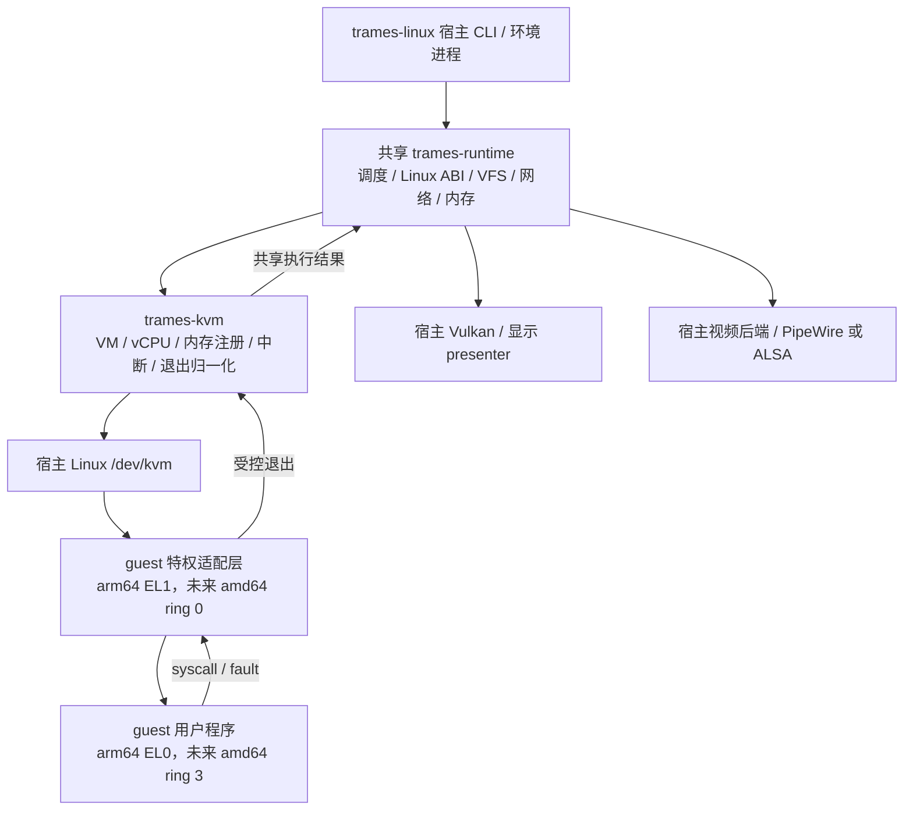

# Trames Linux：共享 runtime 与 KVM 执行后端计划

状态：调研与实施建议，尚未开始实现。日期：2026-11-24。
范围修订：图形、音频、视频 API 桥接属于 arm64 产品核心交付；完整 4 KiB 环境是共享
runtime 与 KVM 后端的必过配置。
执行约束修订：不改写应用/库已装载的执行代码；采用原始指令硬件执行和异常适配，
以现有 HVF 的同线程、mailbox 路径作为设计参考。

本轮交付是计划；创建 `trames-linux` 仓库、实现后端、部署 Linux 测试机另属实施阶段。
现有 runtime 的迭代继续进行，Linux 产品通过明确的 runtime commit 与它共同演进。

## 1. 建议与产品边界

新增独立产品仓库 `trames-linux`，与 iPad、Mac 一样将
`trames-runtime` 固定为 `runtime/` Git submodule。Linux 产品拥有 KVM transport、
Linux 宿主集成与产品入口；Linux guest 的进程、文件、网络、系统调用语义继续由
同一份 runtime 实现。

首期目标是 **Linux arm64 宿主运行 Linux arm64 用户程序**，交付可交互、可持久化、
可多核执行的命令行与图形环境，包含 GPU 加速显示、音频播放/录音和硬件视频能力。
KVM 负责执行 guest 指令，Trames 负责 guest Linux ABI 与共享 API 桥接。
后续增加 **Linux amd64 宿主运行 Linux amd64 用户程序**；把宿主 OS、执行后端、
guest 架构作为三个独立维度，新增代码不将 Linux/KVM 等同于 AArch64。

产品执行不依赖修改已装载的 `svc`/`syscall`、识别 libc wrapper 或替换 JIT 指令。
静态/动态 ELF、内联 syscall、guest 自身动态生成代码都通过原有架构入口执行。
产品装载自己的 EL1/ring-0 适配层及标准 vDSO 属于正常执行环境构造；不将适配代码
植入或替换应用指令。二进制重写、热 patch 和仅拦截 libc 函数不作为产品执行后端。

跨 ISA 执行不由本计划中的 KVM 后端提供；例如 arm64 宿主执行 amd64 ELF 需要另外的
解释器或动态翻译后端。配置必须明确报告不支持的宿主/guest 架构组合。

图形、音频、视频要从接口、资源共享、同步到产品验收完整规划，并进入首个 arm64
产品交付链。底层 bring-up 可以先跑 CLI；产品完成条件包含真实可见图形与音视频，
不能把能力关闭作为这一阶段的最终交付。额外的环境管理 GUI 可后续完善。
核心交付要求产品实现这些后端并在选定真实硬件上通过验收；每台宿主可用的 GPU、
codec 和录音能力仍按实际探测声明。无设备的 headless 模式是明确的运行配置。
Android 产品验收、OCI/containerd 接入与 VM 迁移另列阶段。基础 Linux syscall 仍复用
全部已实现的共享语义，不另做一套精简 syscall 内核。

## 2. 源码调研结论

本次审阅了 iPad 工作区、其中的 runtime，以及独立 Mac 工作区。审阅时 HEAD：

- iPad：`f5b77680`。
- runtime：`42e58346041335df8ef995119abc7f6cfab555ca`。
- Mac：`2a9955862e184d6229fb41f53949f4772b647354`。

HEAD 用于标记调研基线。runtime 工作树存在正在进行的 FUSE、内存及网络等修改；
本文不把这些工作树内容视为已发布、已验证的新基线。实施时重新选择已验证 commit。

| 当前证据 | 对 Linux 产品的含义 |
| --- | --- |
| runtime README 已明确拥有执行契约、内存、ELF、Linux ABI、进程调度与资源语义；产品拥有执行 transport | 第三个产品符合现有拆分方向，不需要 fork runtime |
| `trames-engine::Cpu` 将可移动 task state 与 worker 本地 `Engine` 分开；已有中断、并行 view 和硬件等待接口 | KVM 可以接入现有 worker/scheduler，避免重写进程内核 |
| Mac 用 `Runtime<trames_hvf::kernel::Cpu>`，以小型 EL1 适配层执行原始 ARM64 用户指令 | 可复用设计及公共契约；HVF API 本身需要独立替换 |
| `HardwareStorage`、`HardwareRange`、`SharedMapping` 与 `HardwareWait` 已存在 | KVM 必须接入同一字节所有权、借用撤销和阻塞唤醒契约 |
| runtime 的宿主内存已有 Linux `memfd`/`mmap` 路径，网络已有 Linux 分支；CI 声明 Ubuntu/macOS 构建 | 现有 Linux 宿主基础可复用，但这些检查不证明 KVM 后端已可用 |
| Mac `machine.rs` 明确要求 16 KiB 宿主页，汇编向量包含 SME2 和 Mach-O 符号约定 | 不能整目录复制成 Linux 后端；先分离通用 ARM64 逻辑和平台实现 |
| `Registers` 暴露 `x()`；`Cpu` 快照固定为 `Aarch64State`；ELF 只接受 machine 183；syscall dispatcher 读取 `x8/x0..x5`；signal/ptrace 使用 AArch64 状态 | 当前 runtime 没有完成 guest 多架构抽象，amd64 是一项真实的 ABI 工程 |
| runtime 已有名为 `trames-linux` 的 syscall crate，也有产出 `trames` 的 `trames-control` | 新产品仓库可叫 `trames-linux`，产品 Cargo package 应另命名；宿主 CLI 与 guest 控制程序分开打包 |
| Vulkan 已有动态 loader 路径；guest 图形、VA-API、ALSA 插件及 profile 已存在 | 复用标准 guest API 与调用桥，新增 Linux 宿主实现 |
| `graphics::Image`、`wayland::GpuImage` 仍要求 `metal_texture()`；video/audio 非 Apple 实现不提供实际设备服务 | 先解除公共接口对 Metal 的依赖，再实现 Linux 图像、解码器与 PCM 后端 |
| runtime 宿主页探测接受 4–64 KiB，Vulkan shared memory 已查询宿主 granule | 已有可复用的粒度处理；仍需按全链路验收，不能把个别 Linux 分支视为完整 4 KiB 支持 |

源码入口见文末。本文是源码与官方接口调研，没有运行 KVM、测量性能或证明产品兼容性。

## 3. 执行架构



宿主程序仍是普通用户态进程，使用内核 KVM 接口取得硬件执行能力。guest 特权层负责
异常、页表、寄存器和返回适配，不独立维护另一套 Linux syscall、VFS 或调度器语义。
后文的 guest 轻量快路径仅作为受共享 runtime 契约约束的后续研究项。
这与已有 Mac 产品的分工一致。gVisor 的 KVM 平台也采用进程模型与用户态内核的组合，
可作设计参照，但无需复制它的整套进入/退出机制。[gVisor 官方平台说明](https://gvisor.dev/docs/architecture_guide/platforms/)

### 3.1 arm64 的 syscall 与异常路径

设计路径：EL0 的 `svc` → EL1 vector → 保存 guest 状态和 ESR/FAR/ELR → 受控退出
至宿主 → 共享 runtime dispatch → 写入结果或 signal frame → EL1 恢复 → `eret`。
`svc` 首先进入 guest EL1，不能把它假定为一次直接面向用户态 VMM 的 KVM exit。

退出通道优先原型验证 **HVC/SMCCC 转发 + 每 vCPU mailbox**，与现有 HVF 的机制对齐；
同时保留 **MMIO doorbell + 同一 mailbox** 作为标准接口兼容性基线。HVC 是否更快由
同机实测决定，不能依据名字或异常条数预先排序。只有 EL1 可访问 mailbox、vector、
页表与 doorbell，guest EL0 无权读写其私有控制状态。

SMCCC filter 将明确选择的调用转发为 `KVM_EXIT_HYPERCALL`。普通 `hvc #imm` 不直接
继承 HVF 的退出约定；Linux 适配层选择合法的 SMCCC function ID 与 conduit，先证明
KVM 上的路由和恢复行为。filter 必须在首次执行前配置，并避开保留/冲突范围。
实际 syscall 号、参数和状态置于 mailbox，HVC 仅携带受控路由标识；普通路径不为
取每个参数单独调用 `KVM_GET_ONE_REG`。MMIO 同样只传固定宽度通知，不传宿主指针。
[KVM ARM VM/SMCCC 控制接口](https://docs.kernel.org/virt/kvm/devices/vm.html#group-kvm-arm-vm-smccc-ctrl)

MMIO/相关退出的内核待完成操作，要按 KVM 契约重新进入 `KVM_RUN` 完成后，才允许保存
为可移动 task state、切换地址空间或复用 vCPU。不能只修改 PC 就宣称指令已经完成。
[KVM 退出与完成规则](https://docs.kernel.org/virt/kvm/api.html#the-kvm-run-structure)

归一化后的事件应区分 syscall、内存 fault、非法指令/断点、抢占、协商后的 native call
以及 host transport error。用户内存 fault 进入既有 signal/分页语义；宿主 KVM 错误
保持宿主错误。EL1 自身异常单独诊断，避免递归 vector 或误报成 guest `SIGSEGV`。

### 3.2 VM、进程和 vCPU 的关系

建议首期每个环境对应一个宿主进程、一个 KVM VM；一个执行 worker 持有一个 vCPU。
guest 进程仍使用 runtime 的 PID/mm/files/signal 对象，不映射为宿主进程或独立 VM。
同一环境中多个 mm 由独立 stage-1 页表与 ASID 区分；guest 线程数量不决定 vCPU 数量。

task state 可以迁移到其他 worker；vCPU 在其 worker 中创建、执行和销毁，保留既有
engine 本地所有权。KVM fd/thread 的调用约束也支持这一分工。
[KVM fd 与线程使用约定](https://docs.kernel.org/virt/kvm/api.html#general-description)

产品不增加协调线程、资源服务线程或轮询消息总线。短 syscall 和 native 调用优先在
当前 worker 继续；实际共享资源使用既有对象锁/原子操作。阻塞 I/O、futex、分页等待
归还执行槽，使用现有 `HostWait`/completion/readiness 机制继续。

### 3.3 内存与页表

三层地址必须明确：guest VA → guest physical/IPA → host backing。guest 高虚拟地址
不直接当作 GPA，避免将 guest VA 宽度错误地转成 KVM IPA 要求。

- runtime 是 VMA、权限、COW、共享文件页、backing 生命周期的唯一语义来源。
- KVM 注册稳定 backing arena，stage-1 页表映射这些 arena 中的页。
  slot 数量有上限，应按 arena 分配，不能每个 4 KiB guest page 占一个 slot。
- 初期普通可由宿主访问的共享 RAM backing 即可；保密 VM/private guest memory
  不属于本期，不能妨碍 runtime 对 guest 字节的既有访问。
- ELF、syscall、native 调用与硬件 CPU 观察相同物理字节；普通路径不维护每次退出时
  全量复制或对比的影子 RAM。
- guest 的读写执行权限和 COW 主要由 stage-1 PTE 表达；不以 slot 级 dirty logging
  代替 runtime 的 COW/脏页/文件持久化语义。
- `begin_host_access` 必须在产生 Rust 引用前排除该 backing 的所有硬件访问，包括其他
  mm 的别名；`end_host_access` 后才恢复相应权限。复用现有契约与必要同步边界。
- munmap、mprotect、COW、ASID 复用和 backing 回收包含明确的 PTE 发布、TLBI 与确认
  顺序；只停止实际受影响的参与者。最后一个硬件访问者退出前不能回收 owner。
- 代码发布保留 ARM 所需的 I-cache/D-cache 同步；覆盖宿主装载代码和 guest JIT。
  guest 自修改代码保留其原有架构责任，不给普通数据读写加额外屏障。

KVM 的 slot 上限、内存注册和 IPA 能力都应在启动时探测。
[KVM 内存注册接口](https://docs.kernel.org/virt/kvm/api.html#kvm-set-user-memory-region)

分别记录 `guest_page_size`、`host_page_size`、stage-1 granule、backing 对齐与 arena
大小。**宿主 4 KiB + guest 4 KiB + stage-1 4 KiB 是首期必过配置**，覆盖 runtime、KVM、
native 调用、VFS 和图形音视频资源。它不等于要求所有宿主都为 4 KiB；随后增加
16/64 KiB 宿主页矩阵。
非 4 KiB 宿主先验证 KVM/CPU 支持的 stage-1 粒度，以及子页权限、COW、借用和回收的
可实现性；不满足时清楚拒绝该组合，不能偷偷改变 guest ABI 或放宽相邻子页权限。

Linux 宿主回收先复用普通 demand paging 与既有 runtime 内存预算。避免默认 `mlock`
全部 guest RAM；`MADV_DONTNEED` 只用于语义允许丢弃的页。活跃脏页若要显式回收，需
保留恢复来源或接入已有存储方案；不能把宿主回收直接当作 guest 内容作废。

### 3.4 抢占、计时与异步退出

纯计算循环也必须能被时间片、kill、signal、调试暂停和映射撤销打断。KVM 的
`immediate_exit` 在进入 `KVM_RUN` 时检查；跨线程改这个字节不能单独当作踢出正在执行
vCPU 的机制。设计采用目标线程通知配合 entry gate，并验证丢失唤醒竞态。
[KVM immediate_exit 规则](https://docs.kernel.org/virt/kvm/api.html#the-kvm-run-structure)

候选实现为保留的宿主 signal + 既有 deadline/wakeup 路径；必要时使用内核向目标线程
投递的定时器，不使用会生成额外服务线程的通知方式。handler 只做 async-signal-safe
操作和必要状态发布，不在 handler 里分配、拿 runtime 对象锁或运行 syscall dispatcher。

必须覆盖退出发生在 EL0、vector 保存中、恢复中、doorbell 待完成中等位置的状态恢复。
中断 handle 在 vCPU 销毁或线程标识复用前失效；不以忙等补偿协议缺陷。

硬件指令数保持 unavailable；时间片使用实际时间。guest 时钟、vDSO 与 runtime
monotonic clock 需要一致的域；尚未建立稳定 counter 映射时使用 syscall 时钟路径。
首期不承诺 PMU、SVE/SME、MTE 或 PAC 等扩展，HWCAP/procfs 必须符合实际配置的 vCPU
和已经实现的上下文/ABI，而不是照抄宿主或 iPad 的特性集合。

### 3.5 完整 4 KiB 环境的定义与验收

这项要求属于共享 runtime 的正式能力，不是 Linux 产品里的特殊补丁。4096 字节宿主
与 guest 页在以下路径都必须正常工作：

| 范围 | 必须成立的行为 |
| --- | --- |
| backing/allocator | 4 KiB 页可独立拥有、映射和回收；arena 可大于一页，但不能要求四个相邻 guest 页同时存在 |
| VMA/页表 | 4 KiB 的 mmap/mprotect/munmap/COW/discard/remap、跨页 fault 与 guard page 正确；邻页的权限和数据不受影响 |
| 宿主访问 | mmap/memfd 别名、区域借用、pin/native allocator、CPU view 依据实际粒度；访问范围不因旧 16 KiB 假设扩大 |
| KVM | RAM 和页表按实际对齐注册；MMU、TLB、ASID、并发撤销与回收都在真实 4 KiB Linux 上验证 |
| 图形/视频 | Vulkan mapping、SHM、DMA-BUF 的可映射部分、图像 plane 和 FD 导入导出保持原始 offset/length/owner；尾页 padding 的暴露必须合法且已初始化 |
| 音频 | PCM 跨页读写、共享 ring、事件通知与 close/reopen 不要求 16 KiB 分组 |
| 统计/持久化 | guest 页计数、宿主 backing/RSS、文件脏页/writeback 与预算不混用固定四页倍数 |

分别表达 guest 页、宿主页、设备 allocation/import alignment、non-coherent flush 范围
和图像 stride/modifier。GPU 可能要求比 4 KiB 更大的合法分配或导入对齐，这不改变
runtime 的页语义；为该资源分配满足要求的 backing，或采用明示的兼容路径。
不能把所有 GPU 资源强制对齐到 4096，也不能把设备的较大对齐变成全局宿主页大小。
[Vulkan host pointer 导入对齐](https://docs.vulkan.org/refpages/latest/refpages/source/VkPhysicalDeviceExternalMemoryHostPropertiesEXT.html)

审计常量时区分实际页粒度假设、资源配额、API flag 和测试地址。只修改真正依赖宿主
16 KiB 的逻辑，保留 Apple 16 KiB 宿主的既有行为。runtime 当前部分路径已有动态粒度
处理；Mac 的 16 KiB 限制主要位于其 HVF allocator，不能据此判断整个 runtime 只有
16 KiB 支持，也不能直接将该 allocator 的约束复制到 KVM。

必测包含：只分配一页、地址仅 4 KiB 对齐而非 16 KiB、相邻页为 hole/只读/另一 owner、
跨边界 native 访问、fork-COW 后单页回收、部分文件映射，以及相同 backing 在 CPU、
GPU 和视频消费者间的生命周期。使用真正 `_SC_PAGESIZE == 4096` 的 Linux 机器，
记录 backend 确实使用 KVM；不能靠修改探测返回值或降级成解释器来替代验收。

### 3.6 不改写代码的硬件执行与低固定成本路径

这里的目标是普通指令直接硬件执行、syscall 仅承担必要的异常/退出/处理/恢复成本。
这不等于一次 syscall 只有一条普通指令的成本。HVF 与 KVM 都存在 guest/host 状态
切换；KVM 的用户态返回和重新进入仍有不可忽略的固定成本。

已核对的 Mac 路径是 `svc → EL1 save → hvc → hv_vcpu_run 返回 → 当前线程 runtime`，
由 EL1 将状态存入私有 mailbox，宿主通过它取得结果。它并非每条 `svc` 由 HVF 直接
交给宿主，也不是通过另一个资源线程处理。Linux 首先复用这一分工和正确性边界。

| 层次 | Linux 基线与优化要求 |
| --- | --- |
| 普通用户指令/访存 | 直接由 CPU/MMU 执行，不插入重写、单步或每指令软件分派 |
| guest syscall 入口 | 原始 `svc` 进入产品自己的 EL1 vector；不依赖 syscall 所在库或地址模式 |
| 状态交接 | 每 vCPU 固定布局 mailbox，首次配置好映射和恢复入口；宿主 RAM 与 guest 访问使用同一 owner |
| 退出通道 | 比较 SMCCC/HVC 与 MMIO；避免附带模拟通用设备、解释 guest I/O 指令或多余寄存器 ioctl |
| runtime 处理 | 退出后继续由原 worker 执行共享 dispatcher；短 syscall 不转交协调/服务线程 |
| 恢复 | 尽可能从适配层固定的后续指令恢复，结果写入 mailbox 后重入；遵守 KVM 待完成操作契约 |
| 映射与时钟 | 地址空间未变时复用页表/ASID；仅在真正需要时更新 TLB、timer 和执行控制 |
| 完整状态 | 首版保证全部状态可正确保存；后续冷热拆分必须同时覆盖 task 迁移、clone、signal、ptrace 与抢占 |

同一 mailbox 在 vCPU 运行期间由该执行者拥有、退出后才由宿主访问，不把它改成跨线程
轮询消息总线。不为每个寄存器加原子/屏障；保留真实异步中断和共享资源所需的同步。
如果优化为某些状态驻留 vCPU，必须在跨 worker 或对外观察前完整物化，不能返回一份
实际仍依赖已复用 vCPU 的可移动 task snapshot。

测量明确区分 guest EL0→EL1 异常、guest/host world switch、宿主用户/内核边界、实际
宿主线程调度，以及资源处理耗时。硬件退出可以在同一个 worker 上往返，不等于每次
都发生一次宿主线程调度。每个实现同时报告进入次数、寄存器 ioctl、mailbox 字节、
TLB/timer 更新、实际 context switch、wall time 与 host CPU；不以线程数推断开销。

后续可以评估两类减少退出次数的路径，但不作为 L0/L1 的必要前提：

1. **标准 vDSO/用户态快路径**：由共享 runtime 正常提供 vDSO，正确配置时钟域；
   让已有 guest libc 按正常 ABI 使用它，不替换调用点。普通未竞争用户态原子/futex
   路径照常执行，只有真正需要内核语义时进入 syscall。
2. **guest 特权层轻量处理**：对可严格保持同一语义的只读查询，评估由共享 runtime
   提供状态和规则、在 EL1 直接返回。例如未受 tracing/seccomp 等拦截要求约束的
   task 身份查询。guest filter、ptrace stop、计数、信号/生命周期与并发更新规则都要
   一致；任何条件不满足就走宿主 dispatcher。不能手写一份长期分叉的“简化内核”，
   更不能将普通 I/O、futex 唤醒、clone 或 mmap 假设成无需宿主处理。

后一项需要先解决共享规则的编译/生成边界和一致性证据，不能为了省一次退出在 EL1
复制现有 syscall 实现。GPU/媒体只在原 API 允许的边界内批处理，保持调用顺序、返回
和资源生命周期；不能为提高跑分合并具有独立可见语义的 syscall。

硬件的特殊 trap 能力与 Linux 用户态接口另行区分：ARM FGT 可以涉及 SVC 的 trap，
但此次核对的 Linux `handle_svc()` 将其用于 nested virtualization 的异常转发，没有
提供本产品可直接使用的通用 SVC-to-userspace 处理路径。不能把“CPU 有该能力”视为
标准 KVM 上已有一个可开启的产品开关。
[Linux ARM64 KVM 异常处理源码](https://github.com/torvalds/linux/blob/master/arch/arm64/kvm/handle_exit.c)
若以后研究专用 KVM UAPI/内核扩展，应独立记录硬件覆盖、宿主依赖和维护成本；普通
用户态产品的基线仍为标准 KVM。仅换一个用户态包装库不能消除硬件退出本身的成本。

未来 amd64 保留原始 `syscall`，由 guest LSTAR/ring-0 入口与架构专用退出适配完成。
通用 mailbox/事件契约可共享，HVC 不是跨架构接口；x86 的 I/O exit 等通道按其标准
KVM 契约单独测量，不要求 amd64 仿造 ARM 异常层级。

## 4. 仓库与多架构边界

建议目录，均是待创建内容：

```text
trames-linux/
  Cargo.toml
  runtime/                         # 同一 trames-runtime 的显式 submodule pin
  crates/trames-kvm/
    src/vm.rs                      # fd、能力、memslot 与生命周期
    src/vcpu.rs                    # worker 本地执行、kick、exit 完成
    src/memory.rs                  # HardwareStorage/Range 适配
    src/arch/aarch64/               # EL1、寄存器、页表、异常归一化
    src/arch/x86_64/                # 后续实现，不放伪成功占位
  crates/trames-linux-app/          # package 避开已有 trames-linux crate
    src/                           # 宿主 binary trames、环境/终端/配置
  tests/                           # KVM 集成、共享 fixtures 的驱动适配
  docs/validation/
```

新增共享代码的归属：

| 层 | 负责 | 避免混入 |
| --- | --- | --- |
| runtime 通用语义 | 进程、资源、调度、backing 与借用协议 | KVM ioctl、HVF、宿主 UI |
| runtime guest arch 模块 | syscall 编解码、ELF machine/auxv、signal/ptrace/TLS/vDSO/rseq 等 ABI | `/dev/kvm` 或 AppKit |
| runtime API/资源层 | Vulkan/视频/PCM profile、图像/FD/同步契约及各平台服务适配 | 产品窗口管理策略、KVM ioctl |
| 产品 KVM arch 模块 | 特权适配层、KVM 寄存器映射、硬件页表及退出通道 | 一份新的 Linux syscall 实现 |
| Linux 产品层 | CLI、宿主终端、数据目录、环境生命周期与宿主服务接入 | guest ABI 常量 |

同一 AArch64 特权逻辑若能被 HVF/KVM 原样使用，可在实现第二个调用者时提取到 runtime
的纯架构模块；transport 仍在产品中。先对齐契约和复用可证明相同的逻辑，不把整个
`trames-hvf` 泛化成一个必须同时重写两个产品的巨大 transport 抽象。

### 4.1 arm64 阶段现在就做的约束

- 产品配置分别表达 backend、guest arch 与宿主能力；unsupported 返回明确错误。
- KVM 通用文件不出现 `x8`、`EL1`、AArch64 HWCAP 等架构常量。
- runtime 中为新增/修改的边界提供 guest arch 入口，优先静态分派；不在普通指令
  或内存访问上增加动态分派。
- syscall 的共享操作按语义调用；架构编号/参数寄存器/返回约定在 arch 边界解码。
  迁移时覆盖 worker direct path、fallback、trace、seccomp、restart/ptrace 改写等调用者，
  不能只更改主 dispatcher。
- 将状态、ELF、signal、TLS 等架构依赖显式归档并提供可演进接口；首期保留已有
  AArch64 实现，通过批次迁移受影响调用者，避免为 arm64 KVM 先重写整个 runtime。
- rootfs、guest CLI、fixture 和缓存键携带 guest arch；宿主 ELF 与 guest ELF 另行识别。
  对错误架构在执行前报错，不让它变成非法指令或不明 KVM 失败。

### 4.2 amd64 阶段必须完成的实际工作

后续单独交付 `X86_64State`、syscall 编号/寄存器/结构布局、ELF/auxv、TLS/FS/GS、
signal/rt_sigreturn、ptrace regset、vDSO、rseq 和架构特有控制操作。
`Features` 也需从仅有 HWCAP 的表达扩展到架构自己的能力表示。

KVM 后端增加 ring 0 适配、GDT/IDT/TSS、CR3/页表/PCID 策略、SYSCALL/SYSRET 或
IRET 返回路径、MSR/CPUID 与 x87/SSE/XSAVE 状态。异常与抢占覆盖完整恢复边界。
初期只承诺 amd64 ABI；i386/x32 另列范围。选择与 native amd64 Linux 相符的内存顺序，
不为了统一接口而削弱 x86 语义，也不向 arm64 普通访存叠加 x86 屏障。

这些是支持 amd64 的交付条件，不因创建了 `arch/x86_64` 目录就宣称完成。

## 5. Linux 产品接入范围

bring-up 先前台命令行运行，随后补环境持久化、attach/exec、图形窗口和音视频。
默认以有 `/dev/kvm` 访问权的
普通账号运行；权限或硬件不可用时报告具体原因，不要求产品默认使用 root。
容器/云 VM 的设备透传、宿主虚拟化支持和 nested virtualization 在 doctor 中单独检测。

| 接入点 | 首期方案 | 后续扩展 |
| --- | --- | --- |
| CLI | doctor、直接 ELF/rootfs 执行、退出码、资源限制、CPU 数配置 | env create/start/stop/list、attach/exec、导入导出 |
| 终端 | Linux termios/PTY、窗口尺寸、Ctrl-C、job control、退出恢复 | 多终端与桌面集成 |
| 文件/发行版 | 共享 VFS/distro，独立产品数据目录，显式授权的宿主目录 | 镜像管理与更丰富宿主文件互通 |
| 网络 | 共享网络栈与已有 Linux native egress，DNS/TCP/UDP | 端口发布、可选 TAP；各自独立权限与验收 |
| 时钟/等待 | 既有 runtime deadline/completion/HostWait，Linux 事件源 | 经测量的快速 counter/vDSO 路径 |
| 图形 | Vulkan API 桥、Mesa Zink/EGL、共享 Wayland compositor、Linux Wayland presenter；X11 presenter 为兼容路径 | 更多 Vulkan 扩展、显示协议与设备矩阵 |
| 音频 | guest ALSA 插件 → 共享 PCM profile → 宿主 PipeWire；无 PipeWire 时提供 ALSA 后端，覆盖播放和录音 | 更丰富的声道/格式、应用音频服务互通 |
| 视频 | guest libva 驱动 → 共享视频后端 → Linux VA-API 或选定 SoC 的 V4L2 路径；共享 GPU 图像输出 | 更多 codec/bit depth、硬编与处理能力按下述批次交付 |

不将 guest syscall 一般性转发给宿主同名 syscall。宿主 API 只实现明确的后端服务，
guest FD/PID/namespace/cgroup 与宿主对象保持独立语义。guest 里已有能力不自动等于
宿主设备透传或生产容器隔离保证。

### 5.1 API 透传的统一形式

沿用 **标准 guest 库/驱动 + 版本化 NativeCall profile + 宿主 API 实现**。
调用参数使用明确宽度的 wire record、guest 地址及资源 ID；宿主重新解析指针链、长度、
结构体与扩展，取得现有文件表/资源表的真实对象后，调用宿主原生库。同步短调用在
执行 guest 的当前 worker 完成；异步提交保留任务自己的 owner，完成通知接入现有
eventfd/poll/completion。像素、PCM 与大 buffer 采用共享 backing 或设备资源。

```text
guest Vulkan ICD / Mesa Zink ─ Vulkan profile 0x10006 ─ host libvulkan + GPU driver
guest libva Trames driver ─── video profile  0x10007 ─ host VA-API / codec adapter
guest ALSA Trames plugin ──── audio profile  0x10008 ─ host PipeWire / ALSA
guest Wayland/Xwayland ────── shared compositor ────── Linux Wayland/X11 presenter
                       resources: image/buffer + owned FD/ID + completion/fence
```

已有 arm64 stub 的 `hlt` 经过 KVM EL1 异常归一化后进入同一个 profile registry，仍验证
完整协商的调用 stub；amd64 增加自己的调用 stub/ABI。wire 协议不依赖寄存器命名、
宿主指针宽度隐式转换或 Apple 对象布局。新能力用版本/扩展协商，保持现有产品可用。

该方案不需要 PCI GPU 独占分配或一个远程图形服务。guest 的原生设备发现继续由共享
runtime 提供虚拟 DRM/GBM/FD 语义，宿主驱动只在宿主被实际调用；不把真实 render-node
fd 或任意 DRM ioctl 整体交给 guest。标准 API 的具体支持范围由桥接实现和能力协商决定。

### 5.2 Vulkan、OpenGL 与可见显示

Vulkan 延续现有 guest loader/ICD 和共享 `trames-vulkan`，Linux 宿主使用动态
`libvulkan.so` 与实际 GPU driver。Linux 能力不应被 Apple/MoltenVK 的限制表截断；
对外能力取 guest 前端、桥接语义、宿主驱动三者实际支持的交集。OpenGL/GLES/EGL
继续通过现有 Mesa Zink 路径进入 Vulkan；补齐 Linux 设备发现、扩展和 WSI 差异。

显示复用 runtime 的 Wayland server/场景与 guest Xwayland，新增 Linux presenter。
每个 guest toplevel 对应宿主窗口；处理 configure/resize、popup/subsurface、缩放、
输入焦点、键鼠、IME 与剪贴板。宿主 Wayland 为主路径，X11 是明确的兼容后端。
不将宿主 Wayland socket 的字节和未经转换的 guest FD 直接拼接转发。

资源路径按能力选择：

1. 同一宿主 Vulkan device 上，保留 image/device/queue/lifetime，将源图像直接用于
   presenter 的 GPU 合成，输出到宿主 WSI swapchain；允许必要的 GPU 合成，不做每帧
   CPU readback/upload。
2. 视频跨 API、直接提交给宿主 compositor、或跨进程共享时，使用支持的 DMA-BUF
   导入导出。格式、modifier、plane、设备兼容性与同步必须协商成功，不能只传一个 fd。
3. SHM 软件窗口用真实 memfd/backing；不支持的外部资源路径可用有界、可统计的复制
   fallback。硬件加速与无 CPU 拷贝分别验收，兼容路径明确记录实际 GPU 和复制行为。

Vulkan external memory 与 external semaphore/fence 是分别协商的能力；有 buffer fd
并不等于生产者已经写完。[Vulkan 外部内存与同步](https://docs.vulkan.org/guide/latest/extensions/external.html)
Wayland 对格式/modifier 的 feedback 与 buffer 同步也需分别处理。
[Linux DMA-BUF 协议源码](https://raw.githubusercontent.com/wayland-mirror/wayland-protocols/main/stable/linux-dmabuf/linux-dmabuf-v1.xml)、
[显式同步协议源码](https://raw.githubusercontent.com/wayland-mirror/wayland-protocols/main/staging/linux-drm-syncobj/linux-drm-syncobj-v1.xml)

### 5.3 通用图像、FD 与同步契约

这是 runtime 的公共重构，必须同时迁移 graphics、Vulkan external/WSI、video、Wayland
scene、VFS FD 与 Apple presenter 调用者。当前 `Image::metal_texture()` 和
`GpuImage::metal_texture()` 不能继续作为所有后端的必需接口。

建议将公共图像分为描述、存储能力、使用 lease 与同步状态：

- 描述包含 format/fourcc、modifier、每 plane 的 object/offset/stride/size、可见尺寸、
  crop、alpha；视频补充色彩空间/range/transfer/chroma 与时间戳。
- 存储能力按实际实现提供 `VulkanImage`、`DmaBuf`、`Shm`、Apple 专用 image 等 typed
  lease；Vulkan handle 携带 device 身份和资源 owner，不能在任意 device 复用整数句柄。
- Apple 的 Metal/IOSurface 访问放回 Apple 适配层。Linux 导出的 DMA-BUF 用宿主 OwnedFd
  持有；guest 收到的是共享文件表中的资源能力，保留 dup/fork/SCM_RIGHTS/close 语义。
- 内存共享与 acquire/release 同步分开；明确 producer 完成、Vulkan layout/queue-family
  ownership、外部 sync fd/timeline point、消费者完成与最终归还。buffer FD 关闭、
  Wayland frame callback、实际 buffer release 不是同一个生命周期事件。
- `ready`/completion 接现有通知，不使用定期扫描或 busy poll；未显示、丢帧、销毁、
  device lost 和环境退出都要释放正确 lease，不能释放仍被 GPU 使用的 storage。
- CPU mmap 只有在资源实际允许且同步成立时开放；GPU-only 或 tiled/compressed 图像
  不伪装成 row-linear guest RAM。DMA-BUF 不是普通 memfd，不能假定其 mmap 可注册为
  KVM RAM；设备映射失败时走合法的 buffer/readback 路径并记录复制成本。

图像共享需完整描述布局而非推测线性排列。
[Linux 像素缓冲区交换约定](https://docs.kernel.org/userspace-api/dma-buf-alloc-exchange.html)
CPU 对 DMA-BUF 的访问还遵循 exporter 的缓存/同步要求。
[Linux DMA-BUF 同步接口](https://docs.kernel.org/driver-api/dma-buf.html)

### 5.4 视频：VA-API 与 SoC 后端

保留 guest 的标准 libva 入口与 Trames driver，并把 `trames-video` 的公共状态机与宿主
Decoder/Encoder/Frame 实现分离。Linux 原生 VA-API 后端按设备能力连接宿主 libva；
arm64 SoC 若只提供 V4L2 codec，则实现该设备实际支持的 stateless/stateful 路径。
不能假设所有 arm64 Linux GPU 都提供 VA-API 或同一套 V4L2 控制。
[VA-API 官方接口](https://intel.github.io/libva/group__api__core.html)、
[V4L2 memory-to-memory 接口](https://docs.kernel.org/userspace-api/media/v4l/dev-mem2mem.html)

输入语义明确分开：

- **解析后的 VA picture/slice 参数**：为 Linux 原生 VA 后端增加协商后的结构化转发
  操作，完整翻译参数、buffer、reference surface 与对象 ID。普通 VA 客户端无需为了
  适配码流接口重建 SPS/PPS。不能直接 memcpy guest 的宿主指针字段或混用 VA handle。
- **原始压缩码流**：复用现有 H.264/协商后的 HEVC、AV1 profile；可用宿主
  FFmpeg/libavcodec hardware adapter 管理解析、硬件上下文与输出 frame。它解决的是
  已有完整码流的输入，不会补回普通 parsed VA 调用中本就不存在的原始字段。
  对 V4L2 request 等设备路径单独验证依赖和 codec 支持，不能假定 FFmpeg 自动覆盖。

现有普通 H.264 与原始码流路径保留各自边界；新的 Linux structured-VA 能力不能让
Mac/iPad 误报也支持。硬件 decoder 必须实际创建并完成帧输出，软件 decoder 作为明示
fallback/oracle。硬件 frame 保留在原生 surface；具备能力时通过 DMA-BUF 交给 Vulkan/
显示，避免每帧转 CPU RGBA。[FFmpeg 硬件解码 API 示例](https://ffmpeg.org/doxygen/trunk/hw_decode_8c-example.html)

首轮硬件视频验收至少 H.264 8-bit 4:2:0 解码和实际显示；HEVC/AV1、P010/10-bit、
编解码尺寸、色彩与 reference 约束逐项登记。接口同时规划硬编码：原生输入 surface、
帧/时间戳、codec/profile、rate-control、关键帧、压缩输出、drain/flush/cancel 与 readiness。
先交付硬解闭环，再交付选定设备的一种硬编路径；硬编验收独立记录，不用解码成功代替。
视频处理/转码以真实能力扩展，Vulkan Video 可作为后续 provider，不作为 arm64 通用前提。

### 5.5 音频：标准 PCM 前端与宿主流

复用现有 guest ALSA plugin 和 `0x10008` PCM profile，宿主优先 PipeWire stream，
无 PipeWire 的环境支持非阻塞 ALSA PCM。现有 guest ALSA 插件覆盖的入口明确保留；
需要 PulseAudio/PipeWire 协议的应用可通过 guest 中已有音频服务使用该 PCM 后端，或
另做协议适配，不能仅凭 ALSA 插件就宣称所有音频 API 已覆盖。
[ALSA 插件接口](https://www.alsa-project.org/alsa-doc/alsa-lib/pcm_external_plugins.html)、
[PipeWire stream 接口](https://docs.pipewire.org/page_streams.html)

播放/录音包含设备和格式协商、start/stop/pause/drain、非阻塞 transfer、poll readiness、
延迟与硬件时间戳、underrun/overrun 恢复、设备切换/断开和 teardown。麦克风按产品
授权与宿主会话可见设备开放；无录音能力时如实报告。

使用预分配、有界的 per-stream PCM ring；guest transfer 在 worker 上完成现有内存
访问，RT callback 只消费/填充已拥有的音频存储并发出通知，不保留 guest 切片、借用或
可移动 task state。播放饿死时输出静音并计数，不能让 RT callback 等待 guest。

控制事件优先将普通 PipeWire loop 接入已有宿主事件循环；不为方便同步调用增加
`pw_thread_loop` 控制服务线程。PipeWire/API 本身必需的实时数据执行属于实际媒体生产者，
不承担 runtime 调度或资源协调。共享状态只使用必要的 per-stream 同步；有线程亲和性的
控制操作才投递到既有 loop，并记录通信成本。直接调用、既有 loop 消息和协调器三种
路径按实际成本比较，禁止新增协调器或轮询总线。
[PipeWire threaded loop 的线程与锁约定](https://docs.pipewire.org/page_thread_loop.html)

音频时钟、视频 PTS 与显示时钟建立明确映射，测量 drift/drop/latency；A/V 同步、seek、
暂停恢复和长时间播放属于产品验收，不能只用解码帧率和“听到声音”替代。

## 6. 实施顺序与验收门槛

以完整依赖批次推进：先枚举该批的已知问题、调用者与 fallback，完成实现，再集中
build/test/原生对照/性能验证。失败项汇总修复；源码未变的通过结果直接复用。

| 批次 | 完整实现范围 | 退出条件 |
| --- | --- | --- |
| L0：能力与高风险原型 | 真实 4 KiB arm64 KVM 机器/CI；EL1、退出、寄存器、slot arena、同字节访问、kick；并确认宿主 Vulkan/显示/音频/codec 能力 | syscall/fault 往返、循环可打断、单页权限/COW/回收成立；原生 API 探针得到 GPU、声音及硬解证据；记录开销 |
| L1：共享 runtime 与 API 边界 | 产品 workspace/pin；Cpu/Engine 和硬件内存；通用 image/sync/FD 与视频/PCM provider 契约；迁移公共调用者；前台 CLI | static ELF、fault/signal、TLS/FP/SIMD、mmap；完整 4 KiB 基础；Apple API 资源路径保持可用；API 能力不能伪成功 |
| L2：进程、多核与完整内存 | clone/fork/exec/wait；多个 mm/ASID；COW/共享页；futex/信号/抢占；blocking handoff；文件映射回收；4 KiB native/导入资源 | 1/2/4+ worker 通过；单页生命周期与邻页隔离成立；kill/stop 有界；无 stale page/context；共享语义一致 |
| L3a：CLI 与图形产品 | Alpine/Debian、动态 loader、持久化与网络；Linux Vulkan API 桥、Zink、SHM、Wayland presenter、Xwayland；外部图像和同步 | 包管理/应用；GPU compute 与可见硬件图形；resize/input/IME/clipboard；4 KiB 图像共享与 FD 生命周期；无默认逐帧 CPU readback |
| L3b：音视频闭环 | PipeWire/ALSA 播放录音；Linux 视频 provider、structured VA/码流协商、DMA-BUF 导入、PTS/时钟；硬编输入输出协议与选定设备路径 | guest 音频播放/录音、poll/xrun/设备断开；至少一种 H.264 硬解实际显示；一种硬编路径独立验证；A/V sync/seek/长期运行 |
| L4：arm64 产品发布 | KVM/原生/解释器/HVF 差异；gVisor；真实 GPU/音视频和全链路 4 KiB 矩阵；性能/资源限制/安装包 | CLI、硬件图形、音频与视频通过；无跳过冒充通过；设备能力边界清楚；发布节点所需 CI 和受影响旧产品验收通过 |
| L5：amd64 | runtime guest arch 扩展与 KVM x86_64 的完整依赖批次；amd64 rootfs/tooling | 独立 native amd64 参考、信号/寄存器/内存与应用矩阵；arm64 无回退 |

L0 是首个实施批次，目标是降低退出、4 KiB 内存和抢占风险，并尽早确认媒体测试设备。
L0–L2 为底层依赖链；L1 的公共 API/资源契约为 L3a/L3b 的共同前提。CLI、图形和媒体
provider 可在契约稳定后交错实现，最终统一验收，不能把 L3a/L3b 无限推迟到首版之后。
共享 runtime 的每批修改仍及时集成到 main。
无需等待现有 syscall/FUSE 迭代全部结束才开始 Linux 后端；Linux 首版也不替现有未完成
兼容性条目宣称通过。L0 证据出来后再估算日期与完整工期，不把 Mac 代码行数作为估时。

### 6.1 L0 必须回答的问题

1. SMCCC/HVC 与 MMIO 基线是否都能保存并恢复完整上下文？同机延迟和 host CPU 差别
   如何？每次往返需要几次 KVM_RUN、寄存器 ioctl 与拷贝？待完成操作是否在 task
   handoff 前完成，正常同 task 恢复是否能避免不必要的额外重入？
2. KVM 能否在全部既有硬件借用边界下共享 canonical backing，并在 revoke 确认后安全
   产生宿主引用、释放/复用物理页？arena 的 slot 使用量是否有界？
3. signal kick、entry gate、deadline、vCPU 销毁的竞态是否闭合？在 EL1 部分保存/恢复
   中被打断时，是否保留原 guest 状态？
4. 目标宿主的 guest granule/IPA/特性是否满足所选 profile？4 KiB guest 配合较大宿主页
   的限制究竟来自 KVM、CPU 还是当前 allocator？
5. 共享 runtime 的现有 Linux 路径能否直接使用；仍需调整哪些依赖、初始化与能力探测？
6. 原生 Vulkan、显示、播放/录音、硬件 codec 是否在同一验收配置中可用？哪些资源能
   跨 API 共享，哪些 format/modifier/sync 组合需要兼容路径？完整 4 KiB 是否可端到端执行？

## 7. 验证和性能计划

不能以交叉编译成功、QEMU user-mode 通过或已有 Ubuntu runtime CI，代替真实 KVM
验收。准备一台可访问 `/dev/kvm` 的 arm64 Linux 机器；CI 对没有 KVM 的 runner 显式
分类为 build-only/unsupported，KVM 必测 job 不允许静默 skip 后呈现绿色。

| 维度 | 需要覆盖的证据 |
| --- | --- |
| 指令状态 | GPR、SP/PC、NZCV、TLS、FPCR/FPSR、SIMD；异常 PC；调试 single-step；切换/迁移保存 |
| 退出与抢占 | syscall 返回/restart、MMIO 待完成、EL1 中途 kick、无 syscall 死循环、idle 唤醒、销毁竞态 |
| 内存 | 真实 4 KiB 全链路；单页/仅 4 KiB 对齐/hole/不同 owner 邻页；demand-zero、COW、文件 mmap、共享别名、权限竞争、exec、借用、I-cache、ASID/TLB、失败与回收 |
| 进程/并发 | pthread/futex、fork/exec/wait、vfork、信号/altstack/rt_sigreturn、多个 mm、CPU affinity、公平与阻塞归还执行槽 |
| 资源/权限 | guest FD/PID 不变成宿主权限；EL0 不能写 EL1/mailbox/页表；环境间 RAM 隔离；RLIMIT/cgroup 对应行为和宿主内存预算 |
| 应用 | static/dynamic musl/glibc、BusyBox、Alpine/Debian、包管理、Python/Node、构建工具及网络服务 |
| 图形 | Vulkan compute/像素 oracle、Zink/EGL/GLES、SHM/WSI、可见窗口/resize/输入、Xwayland、IME/剪贴板、FD/lease、显式同步与 device lost |
| 视频 | 硬件身份与 codec/profile、H.264 像素 oracle、VA 参数/原始码流两种输入、reference/seek/flush/cancel、DMA-BUF→GPU 显示、硬编输出独立解码对照 |
| 音频/A-V | guest 播放与实际输出、录音、格式/采样率、poll/xrun、延迟与时钟漂移、A/V sync、暂停/seek、设备断开、长时间运行及退出 |
| 平台矩阵 | arm64 Linux 4 KiB 为必过；真实 GPU/显示/音频/codec 与 CPU/KVM 同时可用；16/64 KiB 和未来 native amd64 按证据扩展 |

优先复用现有 fixture 与 gVisor case 清单，给新产品增加驱动适配；测试源码可抽到共享
位置，不能让 Linux 产品依赖整个 iPad 产品才能构建。运行相同 guest ELF 做 native
Linux 与 Trames KVM 对照；Mac/HVF 和解释器作为语义交叉参考，不能将不同硬件跑分
直接排成后端优劣。

性能记录至少包括：纯 CPU/访存、空 syscall 往返、普通文件/管道/本地 socket、
futex ping-pong、fork/exec、mmap/COW、Node worker 和并行构建；并报告相同工作量、
1/2/4+ worker、CPU 亲和性、宿主内核/CPU/页大小、冷热状态与重复采样。

观察 wall time、吞吐/延迟分布、host CPU、上下文切换、VM exits 分类、ioctl 数、
PTE/TLBI 成本、RSS/PSS、已注册 GPA/slot、实际 backing/驻留、idle CPU。大虚拟内存
预留不等于实际内存占用。先得到基线，再约定回退预算；不预先承诺接近原生百分比。

媒体另记录 CPU/GPU 上传/下载字节、DMA-BUF import/fallback、实际显示/drop、编解码
吞吐、音频 underrun/overrun、端到端 latency 与 A/V drift。原生宿主与 guest 运行相同
内容对照；readback 可用于像素正确性 oracle，生产路径是否复制另行计数。无 GPU 的
软件渲染 CI 和虚拟音频设备测试不能代替实际硬件/用户可见结果。

常规批次只重跑受影响模块、失败项与必要性能样本；跨产品公共边界变更集中验证相关
Mac/iPad 路径。合入/发布节点按范围完成所需 CI；纯计划文档不触发手工全套运行。

## 8. 与 runtime 持续迭代的协作方式

- 每仓库一条 main 开发线；Linux 的并行迭代通过独立产品仓库展开，不长期分叉 runtime。
- Linux 初始 pin 选择真实验证过的 runtime commit。当前 dirty 工作树不作为可发布 pin。
- 共享改动先在 runtime 以完整依赖批次实现和验证；保持与既有实现兼容，更新受影响
  产品的 pin。不能为了 Linux 平台改名或复制现有 syscall crate。
- iPad/Mac 对未受影响且源码相同的路径复用证据；每条记录列出 runtime SHA、产品 SHA、
  架构、宿主和 fixture 版本。产品升级 pin 时补齐其实际受影响的检查。
- 提交并推送验证后的修改，包括相应 pin；保留已测试 commit 身份，不重写已发布历史。
- 本轮文档在现有 roadmap 落地；实施启动后，将跨产品架构决定归入 runtime 文档，
  Linux 的构建、宿主要求和验收记录放入新产品仓库。

## 9. 首批实施建议与未决项

建议以 **L0 + 产品骨架** 为下一次交付批次：先证明最小 EL0/EL1 往返、稳定 RAM 注册、
完整状态恢复、真实 4 KiB 页语义、借用撤销与真正的抢占，并验证宿主媒体 API 可用，
再进入共享 session 和公共图像/音视频接口的接入。

实施前需落实的外部条件是 arm64 Linux KVM 测试机与 CI 运行位置。本轮不假定已有某台
云 VM 暴露 KVM，也不自动采购或部署机器。媒体验收另需真实 GPU/显示会话、播放录音
设备及硬件 codec；无设备的云 KVM 主机只能完成底层和 headless 检查。
默认产品方向按普通账号、CLI+图形音视频、arm64 原生 guest、完整 4 KiB 与共享 runtime
语义推进；最低宿主版本、可选退出通道、非 4 KiB 宿主承诺，均由
L0 的 capability 与实测结果确定。

KVM Rust 封装优先评估 `kvm-bindings`/`kvm-ioctls`，缺失接口只补局部薄封装，避免
复制整份 UAPI。版本、锁文件及 unsafe 条件在 L0 固定。上游已将相关 crate 开发转入
rust-vmm monorepo，应核对当前维护位置，而不是依据旧独立仓库继续选依赖。
[rust-vmm 当前仓库与 crate 清单](https://github.com/rust-vmm/rust-vmm#the-rust-vmm-crates)

不另外引入 guest RAM 语义库作为第二个内存权威，也不因使用 rust-vmm 组件就一并引入
完整虚拟设备模型、guest Linux kernel 或额外服务进程。

## 10. 调研来源

本地源码优先于历史架构文档；以下源码链接代表审阅入口，可能随主线继续变化：

- [runtime 的职责与产品 pin 约定](../../runtime/README.md)。
- [执行状态与中断契约](../../runtime/crates/trames-execution/src/lib.rs)、
  [Cpu/Engine 接口](../../runtime/crates/trames-engine/src/lib.rs)。
- [硬件 backing/借用/等待接口](../../runtime/crates/trames-memory/src/hardware_shared.rs)、
  [Linux/Apple 宿主内存分支](../../runtime/crates/trames-memory/src/mmu/host.rs)。
- [ELF 架构检查](../../runtime/crates/trames-elf/src/lib.rs)、
  [worker syscall dispatch](../../runtime/crates/trames-session/src/syscall_dispatch.rs)、
  [signal frame](../../runtime/crates/trames-kernel/src/signal/frame.rs)。
- [runtime 的 CI 声明](../../runtime/.github/workflows/runtime.yml)、
  [session 依赖](../../runtime/crates/trames-session/Cargo.toml)。
- [现有图像公共接口](../../runtime/crates/trames-graphics/src/lib.rs)、
  [Wayland GPU image 契约](../../runtime/crates/trames-wayland/src/gpu.rs)、
  [Vulkan 原生共享内存](../../runtime/crates/trames-vulkan/src/backend/shared_memory.rs)。
- [视频公共状态与资源](../../runtime/crates/trames-video/src/lib.rs)、
  [现有视频宿主实现](../../runtime/crates/trames-video/src/native.rs)、
  [PCM 状态与 guest 访问](../../runtime/crates/trames-audio/src/lib.rs)、
  [现有音频宿主实现](../../runtime/crates/trames-audio/src/native.rs)。
- [已有 VA-API/码流与音频设计](../architecture/vaapi.md)、
  [共享 Wayland/SHM/显示设计](../architecture/wayland.md)。
- [Mac Cpu 适配](https://github.com/kb5000/trames-mac/blob/2a9955862e184d6229fb41f53949f4772b647354/crates/trames-hvf/src/kernel.rs)、
  [16 KiB 物理 allocator](https://github.com/kb5000/trames-mac/blob/2a9955862e184d6229fb41f53949f4772b647354/crates/trames-hvf/src/machine.rs)、
  [EL1 vector](https://github.com/kb5000/trames-mac/blob/2a9955862e184d6229fb41f53949f4772b647354/crates/trames-hvf/src/vectors.S)。
- 官方外部来源：上文各段所链的 Linux KVM/媒体/DMA-BUF、ARM SMCCC、gVisor、rust-vmm、
  Vulkan、Wayland 协议源码、libva、FFmpeg、PipeWire 与 ALSA；访问日期均为 2026-11-24。
  设计建议与待测假设不等于来源已经证明
  Trames 实现可用。
